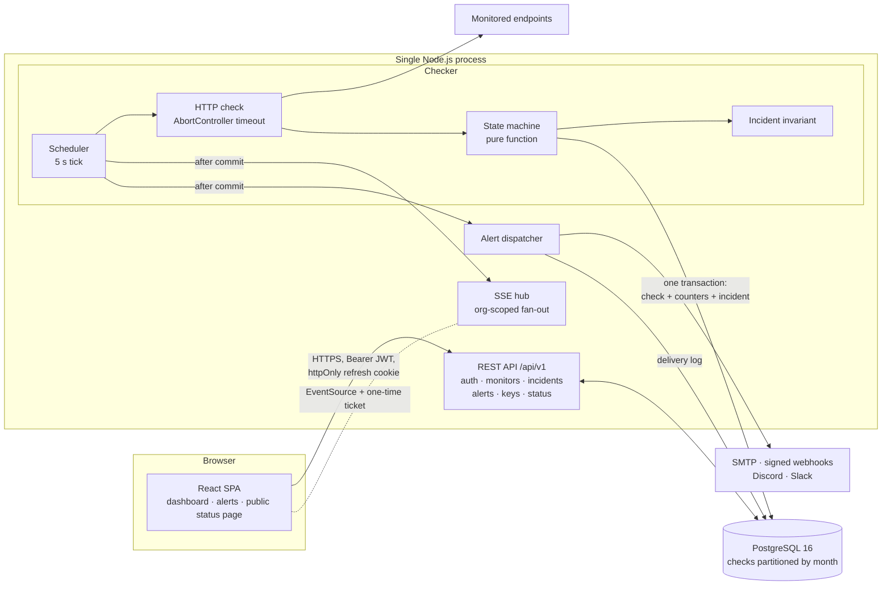
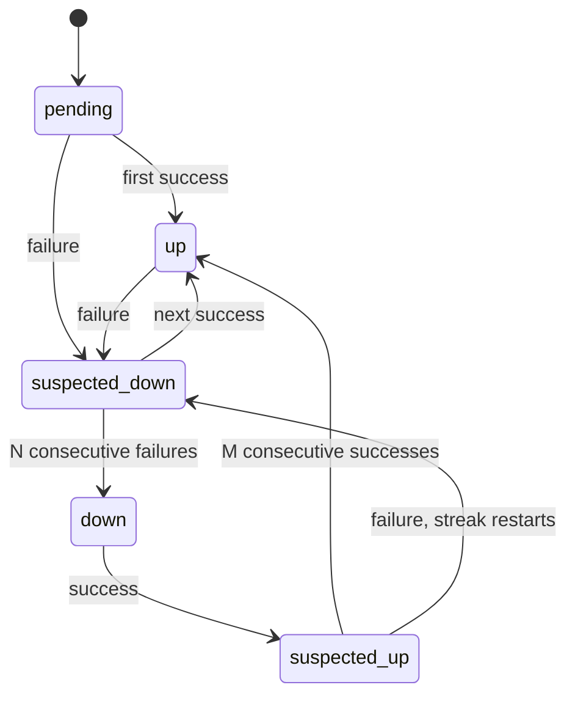
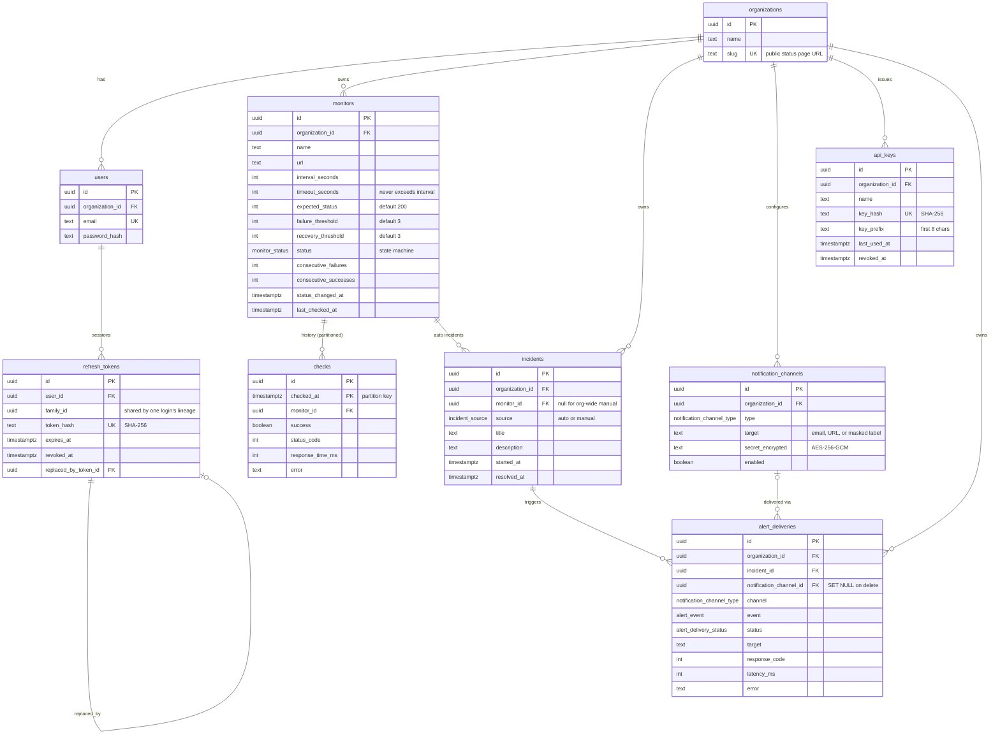

# SitePulse

An uptime monitoring and incident management platform. Teams register HTTP(S) endpoints as monitors, SitePulse checks them on a schedule, tracks response time and uptime history, opens and resolves incidents automatically, sends alerts to email, signed webhooks, Discord or Slack, and publishes a public status page for each organization.

The backend is a single Express service that owns the business rules and also runs the checker. PostgreSQL is the only datastore and the source of truth: correctness-critical guarantees (at most one open auto-incident per monitor, a state machine whose progress survives restarts) live in the schema and in single transactions rather than in application memory. The React dashboard is served by the same process and stays live over Server-Sent Events.

## Architecture



In production the Express process also serves the built React app, so the UI and API share one origin. In development the Vite dev server proxies `/api` to Express, which keeps the refresh-token cookie first-party in both environments.

### Backend structure

Every module follows the same layering, so a request always travels the same path:

```
request
  → rate limiter            (IP-keyed, or API-key-keyed for programmatic traffic)
  → auth middleware         (requireAuth: JWT   |   requireAuthOrApiKey: JWT or X-API-Key)
  → router                  <module>.routes.ts
  → controller              <module>.controller.ts   parses params, validates with Zod
  → service                 <module>.service.ts      business rules + raw SQL via pg
  → PostgreSQL
errors → AppError(status, code, message) → errorHandler → { success: false, error: { code, message } }
```

| Module | Responsibility |
| --- | --- |
| `auth` | Signup, login, JWT access tokens, refresh-token rotation and reuse detection |
| `organizations` | Tenant lookup |
| `monitors` | Monitor CRUD and validation |
| `checker` | Scheduler, HTTP check, state machine, partition maintenance, `/health` logic |
| `incidents` | Incident CRUD and the auto-incident invariant |
| `alerts` | Channels, dispatcher, email / webhook / Discord / Slack senders, AES-256-GCM secret storage, delivery log |
| `sse` | In-memory connection hub, one-time tickets |
| `statuspages` | Public status page query |
| `apikeys` | Issue, verify and revoke API keys |

## Why these choices

- **The database enforces the invariants that matter.** A partial unique index (`UNIQUE (monitor_id) WHERE source = 'auto' AND resolved_at IS NULL`) means two concurrent writers cannot open two incidents for the same monitor; the loser hits the constraint and is treated as a no-op. A `CHECK` constraint backs up the `timeout <= interval` rule for partial updates that Zod cannot cross-validate.
- **Alerting is a state machine, not a reaction to every failed check.** A monitor moves `up → suspected_down → down` only after N consecutive failures, and back only after M consecutive successes. A single timeout never pages anyone.
- **State-machine progress is stored in Postgres, not memory.** `consecutive_failures` and `consecutive_successes` are columns on `monitors`, updated in the same transaction as the check insert. A monitor two failures into a three-failure streak keeps that progress across a restart or deploy.
- **Incidents are a standing invariant, not an edge-triggered event.** After every check write: status `down` ⇒ exactly one open auto-incident exists; status `up` ⇒ none remain. If someone manually resolves an incident while the monitor is still down, the next check reopens it. Edge-triggered creation would never fire again, and the status page would show "operational" during an outage.
- **Alerts are scoped to incidents.** One alert when an incident opens, one when it resolves. A monitor that stays down for an hour sends one alert, not one per check.
- **Alerts are dispatched after the transaction commits.** Sending inside it would let a rollback leave an alert already delivered for an incident that no longer exists, and would hold the monitor's row lock open for the duration of a network call.
- **Raw SQL over an ORM.** All queries use `pg` with parameterized statements. Queries such as the status page's `LEFT JOIN LATERAL` uptime calculation are written and tuned directly. Migrations are plain `.sql` files run by `node-pg-migrate`, which is only a runner, not a data-access layer.
- **In-process scheduler, no queue.** One tick loop, one in-flight `Set` to skip a monitor whose previous check is still running, one database. This keeps the system a single deployable unit; the trade-offs are listed under [Known limitations](#known-limitations).
- **SSE rather than WebSockets.** The dashboard feed is one-directional. SSE is plain HTTP, reconnects natively and needs no extra infrastructure. Because `EventSource` cannot send headers, a client first mints a single-use 30-second ticket over an authenticated request and connects with `?ticket=`.
- **Short-lived access tokens, rotating refresh tokens.** The access token is a 15-minute JWT held only in browser memory. The refresh token is an opaque random value stored only as a SHA-256 hash, delivered as an `httpOnly`, `Secure`, `SameSite=Strict` cookie scoped to `/api/v1/auth`. Every refresh rotates it; presenting an already-rotated token revokes the entire token family.
- **Hash vs. encrypt, chosen per secret.** Passwords use bcrypt (slow, for low-entropy input). Refresh tokens and API keys are high-entropy random values, so a fast, indexable SHA-256 is enough and gives O(1) lookup. Webhook signing secrets and Discord/Slack URLs must be read back in plaintext, so they are AES-256-GCM encrypted instead.
- **Tenant isolation in every query.** Each tenant-owned table carries `organization_id`, and every lookup filters on `(id, organization_id)` together, so another organization's row returns the same 404 as a row that does not exist.
- **Partitioned check history.** `checks` grows by one row per monitor per interval, so it is range-partitioned by month. See [Check-history partitioning](#check-history-partitioning).

## Features

**Monitoring**

- HTTP/HTTPS checks with a per-monitor interval (10 s to 24 h), timeout (1 to 300 s) and expected status code; redirects are followed
- Response time, status code and error stored for every check
- Per-monitor `failure_threshold` and `recovery_threshold` (default 3 / 3, range 1 to 20)
- `GET /health` reports whether the checker itself is still cycling

**Incidents**

- Opened and resolved automatically from monitor state
- Manual incidents (maintenance windows, declared outages) with full CRUD; they are independent of auto-incidents and never fire alerts

**Alerting**

- Channels: email (SMTP), HMAC-signed webhook, Discord, Slack
- One alert on incident open, one on resolve
- Every delivery attempt on every channel is logged with status, latency, response code and error

**Dashboard and status page**

- Live monitor status and incident updates over SSE
- Public status page at `/status/<org-slug>`: overall status, per-monitor 24 h uptime, 14 days of incidents; no login required

**Platform**

- Multi-tenant from the schema up
- Versioned REST API (`/api/v1`) with OpenAPI 3.1 docs and Swagger UI
- API-key authentication for programmatic access, rate limited per key

## Request and event lifecycle

**Check cycle** (every 5 seconds, per due monitor):

```
scheduler tick
  SELECT monitors WHERE last_checked_at IS NULL
                     OR last_checked_at <= now() - interval_seconds
  drop any monitor still in the in-flight Set      (previous check outlived its interval → skipped this tick)
  Promise.all(due monitors):
    fetch(url) with AbortController(timeout_seconds)
      success  = response.status === expected_status
      failure  = other status | network error | timeout
    BEGIN
      SELECT ... FROM monitors WHERE id = $1 FOR UPDATE
      INSERT INTO checks (...)
      nextState(status, counters, thresholds, success)      pure function
      UPDATE monitors SET status, consecutive_*, last_checked_at, status_changed_at
      enforceAutoIncidentInvariant(status)                  opens / resolves the auto-incident
    COMMIT
    broadcast SSE events to the organization              (every status change, incl. suspected_*)
    if an incident opened or resolved → dispatch alerts   (only these two edges alert)
  lastCycleCompletedAt = now()                              (read by /health)
```

**Alert dispatch** (after commit, never throws):

```
load enabled channels for the organization
Promise.all(channels):
  decrypt secret (per channel, so one bad row cannot block the rest)
  email    → Nodemailer SMTP
  webhook  → POST JSON, X-SitePulse-Signature = HMAC-SHA256(secret, "<timestamp>.<body>"), 5 s timeout
  discord  → POST embed to the pasted webhook URL (mentions disabled)
  slack    → POST blocks to the pasted webhook URL (mrkdwn escaped)
  INSERT INTO alert_deliveries (status, latency_ms, response_code, error)   success or failure
```

**Sign-in and token refresh:**

```
POST /auth/signup   one transaction: organization + user (slug collision → SAVEPOINT retry)
POST /auth/login    bcrypt compare (dummy hash if the email is unknown, so timing is uniform)
                    → { accessToken (JWT, 15 min) } + Set-Cookie refreshToken (7 d, path /api/v1/auth)
POST /auth/refresh  SELECT refresh_tokens WHERE token_hash = sha256(cookie) FOR UPDATE
                      already rotated?  → revoke the whole family_id, 401
                      otherwise         → revoke it, insert the replacement in the same family
client              on any 401: one shared refresh promise, retry the request once
page load           access token is memory-only, so the app calls /auth/refresh before routing
```

**Live updates:**

```
POST /sse/ticket                     (Bearer JWT)  → { ticket, expiresIn: 30 }   single-use, in-memory
GET  /sse?ticket=...                 server consumes the ticket, registers the connection under its orgId
server pushes                        monitor_status_changed · incident_opened · incident_resolved
every 25 s                           ": heartbeat" comment frame (keeps proxies from closing the stream)
at 15 min                            server sends "reconnect" and ends the stream
client                               reconnects with a fresh ticket (exponential backoff 1 s → 30 s)
```

The 15-minute cap equals the access-token lifetime, so a logged-out client cannot obtain a new ticket and its stream stops within one window.

## Monitor state machine



`N` is `failure_threshold`, `M` is `recovery_threshold`. The transition function in [`checker.state-machine.ts`](src/modules/checker/checker.state-machine.ts) is pure, with no I/O, so every threshold and flapping scenario is a plain function call in a test. With `failure_threshold = 1` the monitor goes directly `up → down`; the `suspected_*` states exist only while a streak is building. `suspected_down` recovers on the next success with no recovery streak, because the monitor was never actually down.

Worked example with thresholds 3 / 3:

| Check results | Status after | Incident / alert |
| --- | --- | --- |
| ✅ ✅ ✅ | `up` | none |
| ❌ then ✅ | `suspected_down` → `up` | none (a single blip is absorbed) |
| ❌ ❌ ❌ | `suspected_down` → `suspected_down` → `down` | incident opens, 1 alert |
| ❌ ❌ … (still failing) | `down` | same incident, no new alert |
| ✅ ✅ | `suspected_up` | incident stays open |
| ✅ | `up` | incident resolves, 1 recovery alert |

The dashboard receives every status change over SSE, including `suspected_*`, because "something looks wrong" is useful on a screen. Alerts fire only on incident open and resolve. The public status page collapses the five internal states to four: `up → operational`, `suspected_* → degraded`, `down → down`, `pending → unknown`.

## Data model

PostgreSQL 16. Eight plain-SQL migrations in [`migrations/`](migrations), applied by `node-pg-migrate`. All primary keys are `uuid` (`gen_random_uuid()`), all timestamps are `timestamptz`, and a shared `set_updated_at()` trigger maintains `updated_at` on `organizations`, `users`, `monitors`, `incidents` and `notification_channels`.



### Tables

| Table | Purpose |
| --- | --- |
| `organizations` | The tenant. `slug` is unique and forms the public status page URL (`/status/<slug>`) |
| `users` | Account belonging to one organization. Signup creates the organization and the first user in one transaction |
| `refresh_tokens` | One row per issued refresh token. Stores only the SHA-256 hash. `family_id` groups every token descended from one login; `replaced_by_token_id` links a rotated token to its successor; `revoked_at` marks it unusable |
| `monitors` | The check definition (URL, interval, timeout, expected status, thresholds) plus the state machine's persisted memory (`status`, `consecutive_failures`, `consecutive_successes`, `status_changed_at`) and `last_checked_at`, which the scheduler's due-query reads |
| `checks` | One row per executed check: success flag, HTTP status, response time, error text. Range-partitioned by month |
| `incidents` | `source = 'auto'` rows are owned by the invariant and always reference one monitor; `source = 'manual'` rows are user-managed and may reference a monitor or none |
| `notification_channels` | Per-organization alert destinations. `target` holds an email address, a webhook URL, or (for Discord/Slack) a masked label. `secret_encrypted` holds the webhook signing secret or the full Discord/Slack URL, encrypted |
| `alert_deliveries` | Append-only log of every delivery attempt: channel type, event (`incident_opened` / `incident_resolved`), `sent` / `failed`, response code, latency, error |
| `api_keys` | Programmatic credentials. The full key (`sp_live_…`) is shown once; only its SHA-256 hash and an 8-character display prefix are stored. Revoked, never deleted |

### Enums

| Type | Values |
| --- | --- |
| `monitor_status` | `pending` · `up` · `suspected_down` · `down` · `suspected_up` |
| `incident_source` | `auto` · `manual` |
| `notification_channel_type` | `email` · `webhook` · `discord` · `slack` |
| `alert_event` | `incident_opened` · `incident_resolved` |
| `alert_delivery_status` | `sent` · `failed` |

### Constraints and indexes

| Object | Definition | Why |
| --- | --- | --- |
| `incidents_one_open_auto_per_monitor_idx` | `UNIQUE (monitor_id) WHERE source = 'auto' AND resolved_at IS NULL` | At most one open auto-incident per monitor, enforced by the database even under concurrent writers |
| `incidents_auto_requires_monitor` | `CHECK (source = 'manual' OR monitor_id IS NOT NULL)` | An auto-incident without a monitor is meaningless |
| `monitors_timeout_lte_interval` | `CHECK (timeout_seconds <= interval_seconds)` | Backstop for partial updates that Zod cannot validate against the stored row |
| `notification_channels_no_secret_for_email` | `CHECK (type <> 'email' OR secret_encrypted IS NULL)` | Email channels never carry a secret |
| `checks_monitor_id_checked_at_idx` | `(monitor_id, checked_at)` on the partitioned parent | Recent-window queries per monitor; created automatically on every partition |
| `refresh_tokens_token_hash_idx` | `UNIQUE (token_hash)` | O(1) lookup on refresh |
| `refresh_tokens_family_id_idx` | `(family_id)` | Revoke a whole family in one statement |
| `api_keys_key_hash_idx` | `UNIQUE (key_hash)` | O(1) API-key verification |
| `incidents_organization_id_started_at_idx` | `(organization_id, started_at DESC)` | Incident timeline and status page history |
| `alert_deliveries_organization_id_created_at_idx` | `(organization_id, created_at DESC)` | Delivery log, newest first |
| `*_organization_id_idx` | on `users`, `monitors`, `notification_channels`, `api_keys` | Every query is tenant-scoped |

### Delete behavior

| Parent deleted | Effect |
| --- | --- |
| `organizations` | Cascades to users, monitors, incidents, channels, deliveries, API keys |
| `users` | Cascades to their refresh tokens |
| `monitors` | Cascades to checks and incidents (and through incidents to their deliveries) |
| `incidents` | Cascades to their deliveries |
| `notification_channels` | `alert_deliveries.notification_channel_id` is set to `NULL`, so deleting a channel does not erase the history proving what was sent |

### Check-history partitioning

`checks` is the one unbounded table, so it uses native declarative `RANGE` partitioning on `checked_at`, one partition per month (`checks_2026_10`, `checks_2026_11`, …).

- The primary key is `(id, checked_at)`, because the partition key must appear in every unique constraint.
- Range partitioning matches the access pattern (recent windows per monitor), so a 24-hour query is pruned to the current and previous month's partitions instead of scanning all history. Hash partitioning on `monitor_id` would spread writes but force every time-range query across every partition.
- Retention is `DROP TABLE checks_YYYY_MM`, which is instant, rather than a large `DELETE` that bloats the table.
- Postgres never creates partitions automatically; an insert outside every range fails. The scheduler therefore ensures the current month plus two months ahead exist at startup and once a day ([`checker.partitions.ts`](src/modules/checker/checker.partitions.ts)) with `CREATE TABLE IF NOT EXISTS … PARTITION OF checks FOR VALUES FROM … TO …`. Postgres accepts no bind parameters in DDL, so the partition name and bounds are interpolated, after being generated from a `Date` and shape-checked with a regex.
- The status page computes 24 h uptime for all monitors in one query using `LEFT JOIN LATERAL`, relying on the `(monitor_id, checked_at)` index and partition pruning.

### Migrations

| # | Migration |
| --- | --- |
| 1 | `organizations`, `users`, `refresh_tokens`, and the `set_updated_at()` trigger function |
| 2 | `monitors` |
| 3 | `checks` (partitioned) and `monitors.last_checked_at` |
| 4 | `monitor_status` enum and the state-machine columns on `monitors` |
| 5 | `incidents` and the partial unique index |
| 6 | `notification_channels` and `alert_deliveries` |
| 7 | `api_keys` |
| 8 | `discord` / `slack` channel types |

Postgres cannot use a newly added enum value in the transaction that adds it, which is why migration 8 does not add a "chat channels must have a secret" constraint; the delivery code logs a failed delivery for a missing URL instead. Its down migration rebuilds the enum type, because Postgres cannot drop an enum value.

## Frontend

React 19 + Vite + TypeScript, React Router 7. No state library: two React contexts cover the cross-cutting state.

| Piece | Role |
| --- | --- |
| `AuthContext` | Session state: `restoring` (silent refresh on page load) → `authenticated` / `anonymous`. Routing waits during `restoring` so a hard refresh does not bounce a signed-in user to `/login` |
| `LiveContext` (`useReducer`) | Owns the `EventSource`; mints a ticket, connects, and reconnects with exponential backoff and a fresh ticket each time. Exposes live status overrides and an `incidentVersion` counter that pages watch to refetch |
| `lib/api.ts` | Small typed `fetch` wrapper. Keeps the access token in a module variable, attaches `Authorization`, and on a 401 performs one refresh and one retry. Concurrent 401s share a single in-flight refresh promise, since rotation would otherwise treat the second refresh as token reuse |

| Route | Page | Access |
| --- | --- | --- |
| `/` | Landing page | public |
| `/login`, `/signup` | Authentication | redirects away if signed in |
| `/status/:slug` | Public status page | public |
| `/dashboard/monitors` | Monitors with live status | signed in |
| `/dashboard/incidents` | Incident timeline, manual incidents | signed in |
| `/dashboard/alerts` | Channels and delivery log | signed in |
| `/dashboard/settings` | Organization and API keys | signed in |

## Tech stack

- **Runtime:** Node.js 20+, TypeScript (strict), npm
- **Backend:** Express 5, Zod validation, `pg` (raw SQL), `node-pg-migrate`
- **Auth and crypto:** `jsonwebtoken`, `bcrypt`, Node `crypto` (SHA-256, HMAC-SHA256, AES-256-GCM)
- **Alerting:** Nodemailer (SMTP), native `fetch` for webhooks, Discord and Slack
- **API docs:** hand-written OpenAPI 3.1, Swagger UI
- **Rate limiting:** `express-rate-limit`
- **Frontend:** React 19, Vite, React Router 7
- **Database:** PostgreSQL 16
- **Tooling:** Vitest, Supertest, ESLint, Prettier, Docker Compose (Postgres + Mailpit)

## Repository layout

```
.
├── src/
│   ├── index.ts              # entry: HTTP server, scheduler start, graceful shutdown
│   ├── app.ts                # Express wiring: middleware, /health, routes, SPA fallback
│   ├── config/env.ts         # fail-fast environment loading
│   ├── db/pool.ts            # pg Pool with an idle-connection error handler
│   ├── docs/                 # OpenAPI 3.1 spec + Swagger UI route
│   ├── modules/
│   │   ├── auth/             # signup, login, tokens, refresh rotation
│   │   ├── organizations/
│   │   ├── monitors/
│   │   ├── checker/          # scheduler, http check, state machine, partitions, health
│   │   ├── incidents/        # CRUD + auto-incident invariant
│   │   ├── alerts/           # channels, dispatcher, email/webhook/chat senders, crypto
│   │   ├── sse/              # hub + tickets
│   │   ├── statuspages/
│   │   └── apikeys/
│   └── shared/               # AppError, error handler, rate limiters, SPA serving
├── migrations/               # 8 plain-SQL node-pg-migrate files
├── tests/                    # Vitest + Supertest, runs against real Postgres
├── web/                      # React + Vite app (own package.json)
├── planning/                 # PROJECT.md, DECISIONS.md, PROGRESS.md, TASKS.md
├── docker/init-test-db.sql   # creates sitepulse_test on first volume init
├── docker-compose.yml        # Postgres 16 + Mailpit
├── railway.json              # Railway build / pre-deploy / healthcheck config
└── DEPLOYMENT.md             # Railway deployment checklist
```

Each `src/modules/<name>/` folder contains `<name>.routes.ts`, `.controller.ts`, `.service.ts` and, where relevant, `.schemas.ts` (Zod) and `.types.ts`.

## Running locally

### Prerequisites

- Node.js 20+ and npm
- [Docker Desktop](https://www.docker.com/products/docker-desktop/) for Postgres and Mailpit

### Setup

```bash
git clone https://github.com/Shrey0206/SitePulse.git
cd SitePulse

docker compose up -d                 # Postgres on :5432, Mailpit (SMTP :1025, inbox UI :8025)

cp .env.example .env
cp .env.test.example .env.test
# generate a key for WEBHOOK_SECRET_KEY and paste it into .env:
node -e "console.log(require('crypto').randomBytes(32).toString('hex'))"

npm ci
npm run migrate:up                   # apply migrations to the dev database
npm run dev                          # API on http://localhost:3000

# second terminal
npm --prefix web ci
npm --prefix web run dev             # UI on http://localhost:5173, proxies /api → :3000
```

Open http://localhost:5173, sign up, and add a monitor. To see an alert end to end, add an email channel, point a monitor at a URL that returns `500` (or set an expected status the site never returns), and after the failure threshold the incident opens and the email appears in Mailpit.

| Service | URL |
| --- | --- |
| Frontend (dev) | http://localhost:5173 |
| Backend API | http://localhost:3000 |
| Swagger UI | http://localhost:3000/api/v1/docs |
| Mailpit inbox | http://localhost:8025 |

### Scripts

| Command | Purpose |
| --- | --- |
| `npm run dev` | API in watch mode (`tsx watch`) |
| `npm run build` / `build:web` / `build:all` | Compile the API / build the web app / both |
| `npm start` | Run the compiled API; it also serves `web/dist` |
| `npm run lint` / `npm run format` | ESLint / Prettier |
| `npm run typecheck` | `tsc` over source and tests |
| `npm run migrate:up` / `migrate:down` | Apply / revert dev migrations |
| `npm run migrate:create <name>` | Create a new SQL migration |
| `npm run migrate:test:up` | Apply migrations to the test database |
| `npm test` / `npm run test:watch` | Run the test suite |

### Troubleshooting

**Tests fail with `database "sitepulse_test" does not exist`.** The init script only runs against a fresh Postgres volume. Create the database by hand:

```bash
docker compose exec postgres psql -U sitepulse -c "CREATE DATABASE sitepulse_test;"
npm run migrate:test:up
```

**The app exits at startup with `Missing required environment variable`.** `DATABASE_URL` and `JWT_SECRET` are required; copy `.env.example` to `.env`.

**Creating a webhook, Discord or Slack channel fails.** `WEBHOOK_SECRET_KEY` is unset. It must be 32 bytes, hex-encoded (64 characters).

## HTTP API

Base path `/api/v1`. Interactive documentation is served at `/api/v1/docs` (Swagger UI) with the raw spec at `/api/v1/docs/openapi.json`. The spec is hand-written and a test calls every documented operation to catch drift.

Responses use one envelope: `{ "success": true, "data": … }` on success, `{ "success": false, "error": { "code", "message" } }` on failure. Authenticated requests send `Authorization: Bearer <accessToken>`, or, on endpoints that allow it, `X-API-Key: sp_live_…`.

**Auth**

| Method | Path | Auth | Description |
| --- | --- | --- | --- |
| POST | `/auth/signup` | none | Create an organization and its first user (rate limited) |
| POST | `/auth/login` | none | Log in; returns an access token and sets the refresh cookie (rate limited) |
| POST | `/auth/refresh` | refresh cookie | Rotate the refresh token, issue a new access token |
| POST | `/auth/logout` | refresh cookie | Revoke the session |
| GET | `/auth/me` | JWT | Current user |
| GET | `/organizations/me` | JWT | Current organization |

**Monitors** (JWT or API key)

| Method | Path | Description |
| --- | --- | --- |
| POST | `/monitors` | Create a monitor |
| GET | `/monitors` | List the organization's monitors |
| GET | `/monitors/:id` | Read one |
| PATCH | `/monitors/:id` | Update (at least one field) |
| DELETE | `/monitors/:id` | Delete, cascading its check history |

**Incidents** (JWT or API key)

| Method | Path | Description |
| --- | --- | --- |
| POST | `/incidents` | Create a manual incident |
| GET | `/incidents` | List incidents |
| GET | `/incidents/:id` | Read one |
| PATCH | `/incidents/:id` | Update a manual incident |
| POST | `/incidents/:id/resolve` | Resolve an incident |
| DELETE | `/incidents/:id` | Delete a manual incident |

**Alerts** (JWT)

| Method | Path | Description |
| --- | --- | --- |
| POST | `/alerts/channels` | Create a channel (`email`, `webhook`, `discord`, `slack`) |
| GET | `/alerts/channels` | List channels (secrets never returned) |
| PATCH | `/alerts/channels/:id` | Update or enable / disable a channel |
| DELETE | `/alerts/channels/:id` | Delete a channel |
| GET | `/alerts/deliveries` | Delivery log, newest first |

**API keys** (JWT only; key management is not available to API keys)

| Method | Path | Description |
| --- | --- | --- |
| POST | `/keys` | Issue a key; the full value is returned once |
| GET | `/keys` | List keys (prefix, last used, revoked) |
| DELETE | `/keys/:id` | Revoke a key |

**Live updates**

| Method | Path | Auth | Description |
| --- | --- | --- | --- |
| POST | `/sse/ticket` | JWT | Mint a single-use ticket (30 s) |
| GET | `/sse?ticket=…` | ticket | Open the event stream |

**Public**

| Method | Path | Description |
| --- | --- | --- |
| GET | `/status/:slug` | Status page data: `overallStatus`, monitors with `uptime24h`, incidents from the last 14 days. Sent with `Cache-Control: public, max-age=15` |
| GET | `/health` | Liveness, database, and checker health (outside `/api/v1`) |

**Health response:** `200` with `status: "ok"` normally; `"warning"` if the checker's last completed cycle is older than twice the longest monitor interval; `"starting"` during a 15 s boot grace period; `503` only when the database is unreachable.

**Rate limits**

| Limiter | Applies to | Key | Limit |
| --- | --- | --- | --- |
| Auth | signup, login | IP | 20 per 15 min |
| Session | monitors, incidents, alerts, keys, sse, organizations, refresh / logout / me | IP | 120 per min |
| Public | status pages, docs | IP | 300 per min |
| API key | monitors and incidents, when called with `X-API-Key` | key ID | 600 per min |

Limits are in memory, and `trust proxy` is set to `1` so the limiter sees the real client IP behind the platform's reverse proxy.

## SSE events

Events pushed on `GET /sse`, all scoped to the connected organization:

| Event | Payload | When |
| --- | --- | --- |
| `connected` | `{ orgId }` | Stream opened |
| `monitor_status_changed` | `{ monitorId, name, previousStatus, status, at }` | Any status change, including `suspected_*` |
| `incident_opened` | `{ incidentId, monitorId, name }` | An auto-incident opened |
| `incident_resolved` | `{ incidentId, monitorId, name }` | An auto-incident resolved |
| `reconnect` | `{ reason: "max_connection_age" }` | Server is closing the stream at 15 min |

```js
const { data } = await api.post('/sse/ticket');                 // Bearer JWT
const es = new EventSource(`/api/v1/sse?ticket=${data.ticket}`);
es.addEventListener('monitor_status_changed', (e) => { /* JSON.parse(e.data) */ });
es.onerror = () => { es.close(); /* mint a new ticket, then reconnect */ };
```

## Configuration

Copy `.env.example` to `.env`. Local defaults work apart from the secret key.

| Variable | Required | Description |
| --- | --- | --- |
| `DATABASE_URL` | yes | PostgreSQL connection string |
| `JWT_SECRET` | yes | Signs access tokens; rotating it signs everyone out |
| `NODE_ENV` | in production | Set `production` so the refresh cookie is marked `Secure` |
| `PORT` | no | Default `3000` (injected by Railway) |
| `WEBHOOK_SECRET_KEY` | for webhook, Discord, Slack | 32 bytes, hex. Encrypts stored secrets. There is no key versioning, so changing it makes existing secrets undecryptable |
| `SMTP_HOST`, `SMTP_PORT` | for email | Default `localhost:1025` (Mailpit) |
| `SMTP_SECURE` | no | `true` for implicit TLS on port 465; STARTTLS is used otherwise |
| `SMTP_USER`, `SMTP_PASSWORD` | for authenticated relays | |
| `SMTP_FROM` | no | Sender address, default `alerts@sitepulse.local` |
| `BCRYPT_ROUNDS` | no | Default `12` |

## Deployment

The repository is configured for [Railway](https://railway.app): [`railway.json`](railway.json) sets a Nixpacks build (`npm --prefix web ci --include=dev && npm run build:all`), `npm run migrate:up` as the pre-deploy command, `npm start` as the start command and `/health` as the healthcheck. The build produces both `dist/` (API) and `web/dist` (UI); the API process serves the UI.

Run **exactly one instance**: the scheduler, rate limiter, SSE hub and SSE tickets all live in process memory. Set `DATABASE_URL`, `JWT_SECRET`, `WEBHOOK_SECRET_KEY` and `NODE_ENV=production` on the service before the first deploy. The step-by-step checklist, smoke tests, rollback notes and a symptom → cause table are in [`DEPLOYMENT.md`](DEPLOYMENT.md).

Railway disables outbound SMTP on its Free, Trial and Hobby plans, so email alerts cannot send there. Webhook, Discord and Slack channels use plain HTTPS and work on every plan.

> A Railway deployment has not been run yet, so there is no live URL. The deploy configuration and production build were verified locally.

## Operational notes

- **Startup.** The HTTP server starts first; the scheduler starts without blocking it, ensures the check partitions exist, then runs its first cycle.
- **Graceful shutdown.** On `SIGTERM` / `SIGINT` the process stops the scheduler, closes SSE streams, drains the HTTP server, closes the pool, and exits; a 10-second cap prevents a hung deploy. In-flight checks are abandoned, but the persisted counters mean no detection progress is lost.
- **Checker self-monitoring.** `/health` reports the last completed cycle and degrades to `warning` if the checker has stalled, so a monitoring tool does not fail silently.
- **Database connection errors.** The pool has an `error` listener so a dropped idle connection is logged and replaced rather than crashing Node.
- **Log hygiene.** Repeated identical scheduler failures are collapsed into a counter, so a long database outage does not bury the log.
- **Single instance.** Running more than one would double every check and alert, and split SSE and rate-limit state.

## Testing

Tests run against a real PostgreSQL database rather than mocks, so the guarantees described above (the partial unique index, transactional check writes, partition creation, refresh-token reuse detection) are exercised for real.

```bash
docker compose up -d postgres mailpit
npm run migrate:test:up
npm test
```

- **State machine:** the pure transition function is tested directly across threshold and flapping permutations.
- **Everything else:** integration tests through the HTTP layer with Supertest, covering auth, monitors, incidents, alert channels, webhook signatures and encryption, chat channels, SSE, status pages, API keys, the OpenAPI spec, and checker behavior including partition rollover across a year boundary.
- **Isolation:** tables are truncated between tests and files run serially, since they share one database.
- **Cross-tenant tests** assert that one organization cannot read or modify another's monitors, incidents, channels or keys.

The suite last passed at 145 tests (recorded in [`DEPLOYMENT.md`](DEPLOYMENT.md)). The frontend has no automated tests.

## Known limitations

- **Single instance.** The scheduler, SSE hub, SSE tickets and rate-limit counters are in process memory. Scaling out would require a queue for checks and Redis for fan-out and rate limiting.
- **In-flight checks are lost on restart.** The persisted counters keep detection progress, but a check that was mid-request when the process stopped is not retried.
- **No webhook or email retry.** Each alert is a single attempt with a 5 s timeout; failures are recorded in `alert_deliveries` but not redelivered.
- **No flap cooldown.** A monitor that repeatedly completes full down → up cycles opens one incident and sends one alert per cycle.
- **Access tokens cannot be revoked early.** After logout or a refresh-family revocation, an already-issued access token remains valid for up to 15 minutes.
- **SSRF.** Monitor URLs and generic webhook URLs only have to be `http(s)`, so a signed-in user can make the server request internal addresses and see the result in check history. Discord and Slack channels are not affected because they are pinned to those services' hosts. Private, loopback and link-local ranges must be blocked (after DNS resolution and on redirects) before exposing signup to untrusted users.
- **Open signup without email verification.**
- **Tenant isolation is application-level.** It relies on every query scoping by `organization_id`; Postgres Row-Level Security would make a missed filter fail safe.
- **API keys are full-access and do not expire** until revoked.
- **Monitor detail page is not built.** There is no response-time chart or paginated check history in the UI yet, although the data is stored.
- **Email cannot send from Railway's Free, Trial or Hobby plans.**
- **Not yet deployed and not load tested.**
